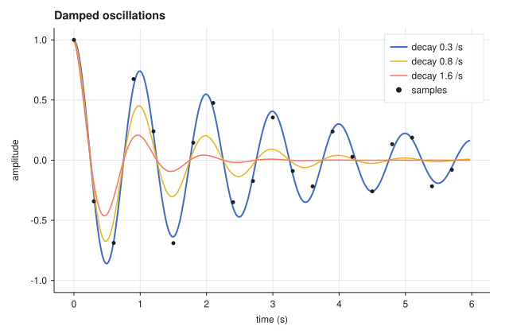

# rapl-plot

**Plotting for [rapl](https://github.com/JErnestoMtz/rapl) arrays.**

Marks are plain values built from arrays, `+` layers them, and the shape of
the data decides what is drawn: a `[n, k]` array is `k` curves, and options
such as labels and widths broadcast against them.

```rust
use rapl::*;
use rapl_plot::*;

fn main() -> Result<(), rapl_plot::Error> {
    let t = Ndarr::from_fn([240], |ix| ix[0] as f64 * 0.025);
    let decay = Ndarr::from([0.3, 0.8, 1.6]);
    // [240, 3]: one damped oscillation per column.
    let waves = Ndarr::from_fn([240, 3], |ix| {
        let t = t[[ix[0]]];
        (-decay[[ix[1]]] * t).exp() * (std::f64::consts::TAU * t).cos()
    });

    line(&t, &waves)
        .label(decay.map(|d| format!("decay {d} /s")))
        .title("Damped oscillations")
        .x(axis().label("time (s)"))
        .y(axis().label("amplitude").lim(-1.1, 1.1))
        .save("waves.svg")
}
```



The picture is `cargo run --example lines`, which also layers a `scatter`.

> `rapl-plot` is in early development and the API will change.

## Getting started

```sh
cargo add rapl rapl-plot
# or, with PNG output:
cargo add rapl rapl-plot --features rapl-plot/png
```

## PNG

SVG needs no dependencies beyond rapl. PNG is behind the `png` feature,
which pulls in [resvg](https://github.com/linebender/resvg) to rasterise the
same SVG.

```rust
plot.save("waves.png")?;                               // 2x the figure size
Figure::from(plot).scale(1.0).size(800.0, 500.0).to_png()?;   // bytes
```

Text is drawn with the fonts installed on the machine.

## How it fits together

- **Marks** (`line`, `scatter`) take any `Ndarr` view of numbers. `y` has
  shape `[n, ...]`: axis 0 runs along the points and every other axis is a
  series. `x` is `[n]`, or the same shape as `y`.
- **Channels** are the options of a mark (`color`, `width`, `size`,
  `opacity`, `dash`, `label`). Each takes one value, or an array that
  broadcasts against the series; `scatter` also takes one value per point.
  Labels are arrays of anything `Display`.
- **`Plot`** is one set of axes. `a + b` layers marks; `.x(axis()...)` and
  `.y(axis()...)` set limits, ticks (a count, or positions as an array),
  tick labels, a formatter and the grid.
- **`Figure`** adds a size and a `Theme` and renders: `to_svg`, `save`
  (`.svg`, or `.png` with the `png` feature) and `show`, which opens the
  system's viewer.
- Lines with far more points than pixels are thinned to what shows, so a
  million-point trace is a small file. `Figure::full_resolution` turns
  that off.
- Nothing fails until you render: `to_svg` and `save` check shapes and axis
  settings and name the mark at fault.

## Status

| Area | State |
| --- | --- |
| SVG output, themes, `show` | done |
| PNG output (`png` feature) | done |
| Thinning of long lines | done |
| `line`, `scatter`, layering, legend | done |
| Linear axes: automatic and custom ticks, labels, limits | done |
| Colormaps, color from data, colorbar | next |
| `heatmap`, `image` | next |
| `bar`, `hist`, `band`, reference lines, text | planned for 0.1 |
| Log axes | planned for 0.1 |
| Grids of plots with shared axes | planned for 0.1 |
| Polar axes, Smith chart, contours | later |

## Development

```sh
cargo test                          # unit tests, SVG structure tests, doctests
cargo test --all-features           # the same plus PNG output
cargo clippy --all-targets --all-features
cargo run --example lines           # writes lines.svg
cargo run --example gallery         # writes gallery_*.svg
```

## License

MIT.
